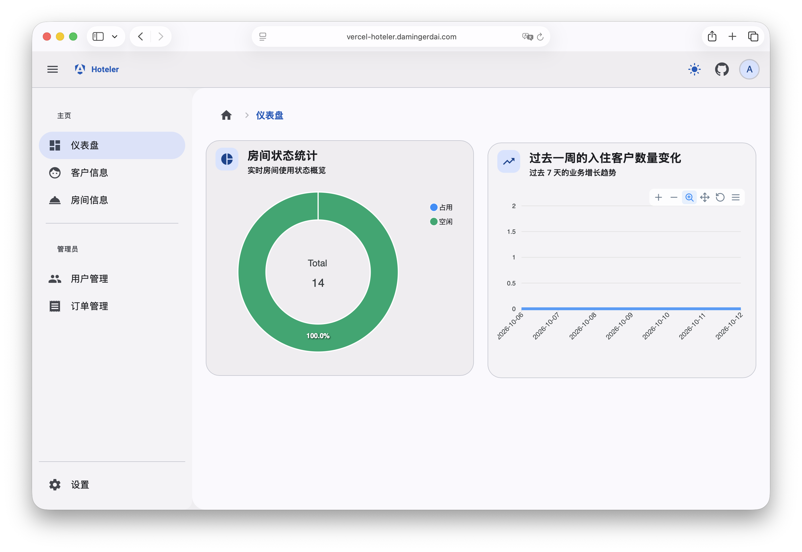
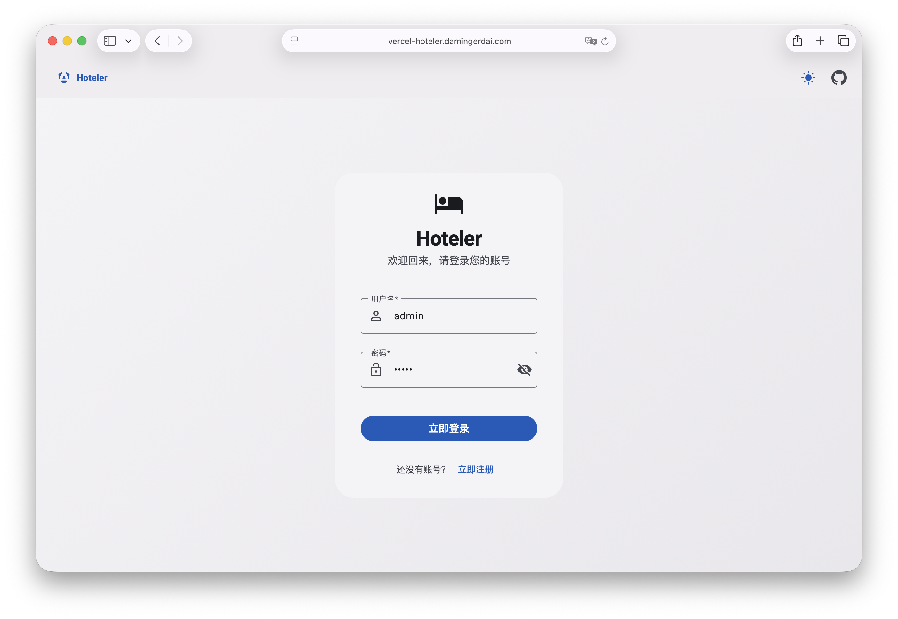
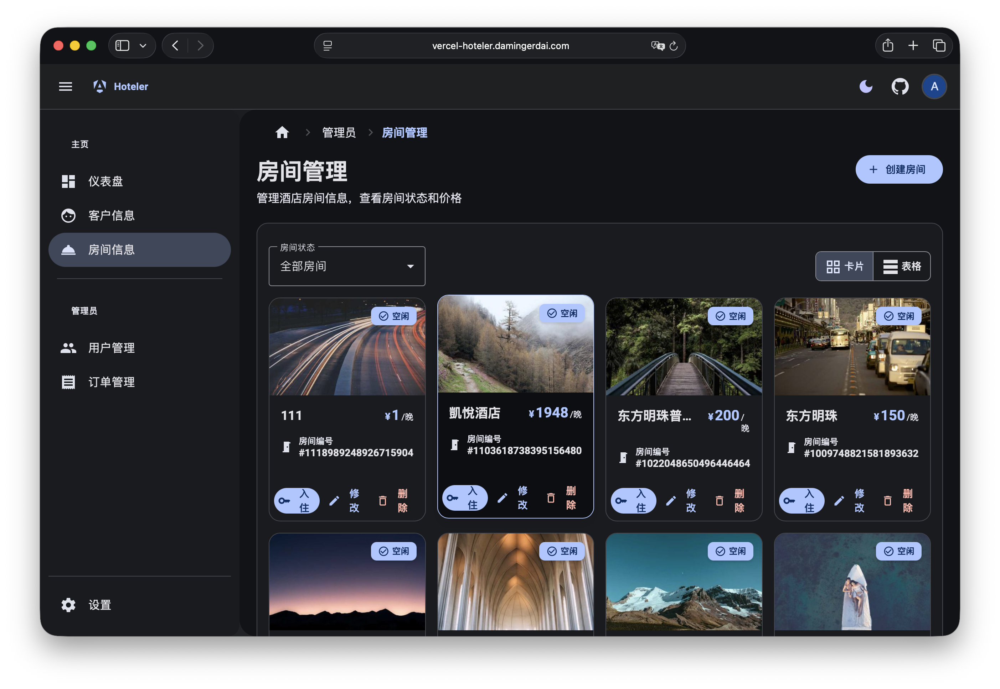
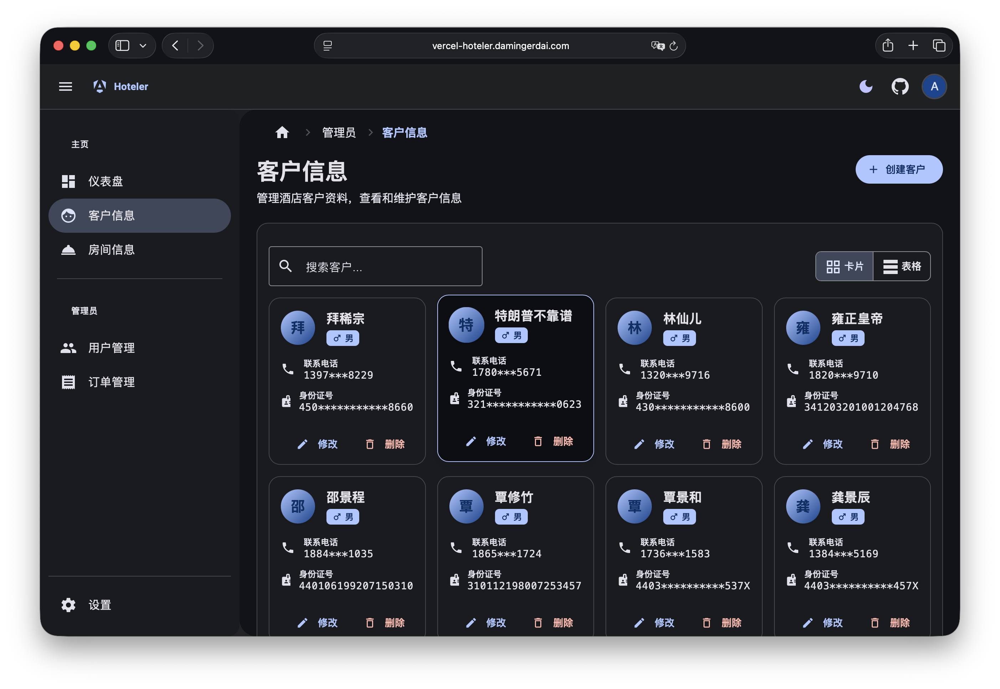
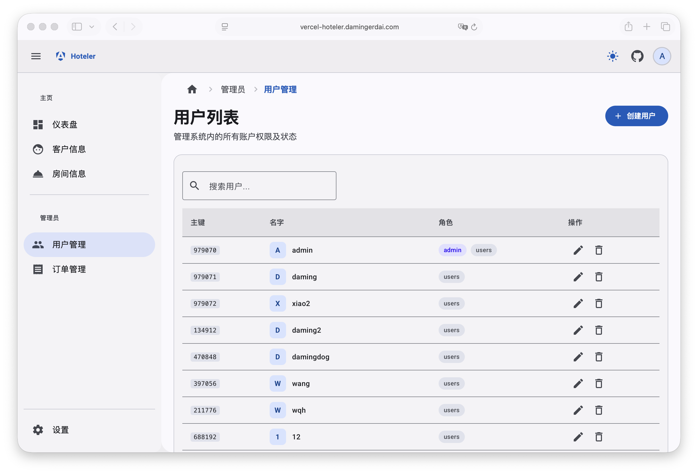
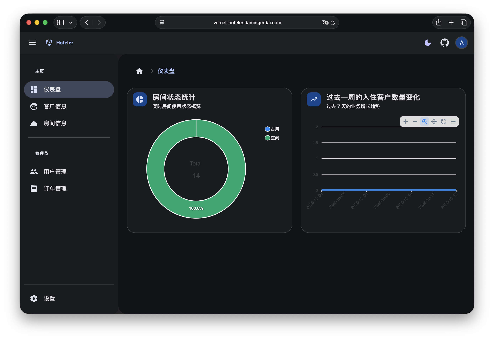

# Hoteler Web

<p align="center">
  
  
  
  
</p>

<p align="center">
  <strong>Built for hospitality teams</strong>
</p>

<p align="center">
  
</p>

Hoteler Web is the modern frontend for the [hoteler](https://github.com/damingerdai/hoteler) platform — a premium operational dashboard built to help hotel teams manage rooms, customers, staff access, orders, and daily service workflows from one system.

Built for hospitality businesses that need order, clarity, and speed, it brings a polished product experience to real-world hotel operations.

<p align="center">
  
  
  
  
</p>

## Why hospitality teams use it

- Streamlined daily hotel operations from a single control panel
- Better visibility into room status, performance, and service readiness
- Cleaner guest and customer relationship management
- Simpler internal staff access and permission control
- A more premium interface for both web and desktop environments
- A modern foundation ready for real product deployment

## Feature highlights

<div align="center">

| Capability           | Business value                                                |
| -------------------- | ------------------------------------------------------------- |
| 🏨 Room operations   | Keep occupancy and room readiness visible and easy to manage. |
| 👥 Guest management  | Centralize customer records and service context.              |
| 📊 Insight dashboard | Monitor hotel activity through a clean operational overview.  |
| 👤 Role-based access | Manage staff permissions with clear structural control.       |
| 🧾 Order workflows   | Track key tasks and service operations in one place.          |
| 🌓 Theme support     | Use a comfortable light theme or focused dark mode.           |
| 🖥️ Desktop-ready     | Package and ship the same experience through Tauri.           |

</div>

## Product showcase

<p align="center">
  <table>
    <tr>
      <td></td>
      <td></td>
      <td></td>
    </tr>
    <tr>
      <td></td>
      <td></td>
      <td></td>
    </tr>
  </table>
</p>

> Built to connect a hotel’s operational workflow to a modern web application, with deployment patterns that work for both browser-based and desktop environments.

## Built with

- Angular 22
- Angular Material
- Tailwind CSS
- RxJS + Angular Router
- TypeScript
- Vitest
- ESLint + Stylelint
- Tauri

## Getting started

### Prerequisites

- Node.js 24+
- npm

### Install dependencies

```bash
npm install
```

### Run locally

```bash
npm start
```

### Production build

```bash
npm run build -- --configuration production
```

### Test suite

```bash
npm test
```

### Lint

```bash
npm run lint
```

## Backend integration & deployment

Hoteler Web is designed to work as the frontend layer of a larger hospitality platform and integrates with a backend via `/api/v1/...` routes.

The frontend uses a proxy configuration in `src/proxy.conf.js` to support local development and environment-specific deployment patterns.

Example local config:

```bash
BACKEND_URL=http://localhost:8443
```

This makes it easy to connect the app to a local backend during development, then deploy the same UI against a hosted backend or production environment with minimal changes.

## Project structure

- `src/app/routes` — dashboard, room, customer, user, settings, and orders features
- `src/app/core` — shared services, API logic, guards, and initialization
- `src/app/layout` — application shell and navigation structure
- `src-tauri` — desktop packaging with Tauri
- `screenshots` — UI assets used for product presentation and documentation

## Related repository

- Backend: [hoteler](https://github.com/damingerdai/hoteler)

## Summary

Hoteler Web brings a startup-grade product experience to hotel management: cleaner operations, faster decisions, and a more polished workflow for hospitality teams that need software they can trust every day.
